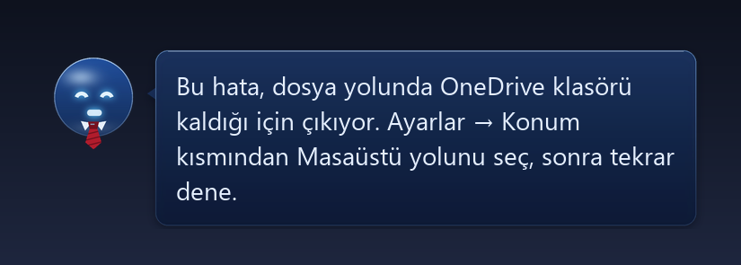
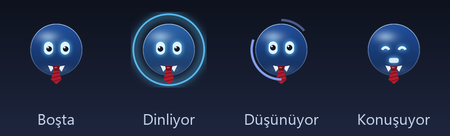
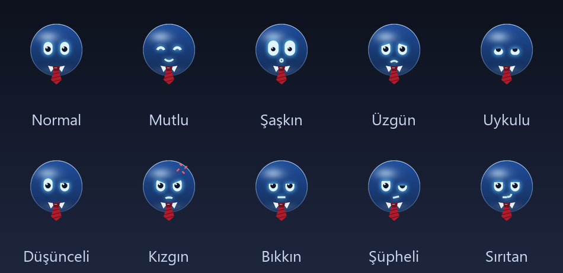
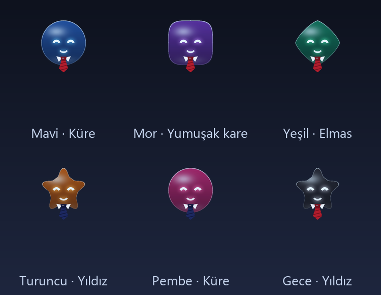

# Kanzi — imlecin yanında duran masaüstü asistanı

Kanzi, Windows'ta imlecin yanında duran küçük, huysuz ama yardımsever bir cam küre. Ekrana bakar, ne gördüğünü açıklar, bir şeyi nasıl yapacağını ok ile göstererek adım adım öğretir ve izin verirsen bilgisayarda işi kendisi yapar. Sesle ya da yazarak konuşursun, cevabı baloncukta yazar ve Türkçe sesle okur.

Beyni [Claude Code](https://docs.anthropic.com/claude-code) (`claude -p`, akışlı). Basit sorular ise internete hiç çıkmadan, bilgisayardaki küçük bir yerel modelde (Ollama) cevaplanır.

*A Turkish desktop assistant that lives next to your mouse cursor: it looks at the screen, explains, teaches step by step by pointing with an arrow, and can operate the computer when allowed. Claude Code is the brain for screen and action tasks; simple questions are answered locally (Ollama via OpenJarvis). Whisper for speech, edge-tts for voice, a Pillow-drawn character with ten expressions, and a safety hook that gates every shell command.*

## Ekran görüntüleri

*Görseller uygulamanın kendi çizim kodundan (`gorunum.py`) üretildi.*

**Cevap verirken:** cevap baloncukta akarak yazılır, ilk cümle biter bitmez sesli okunmaya başlar


**Durumlar:** dinlerken sesine göre büyüyen halka, düşünürken dönen yay, konuşurken ağız hareketi


**Yüz ifadeleri:** iş bitince sırıtır, hata olunca kızar, uzun süre dokunulmazsa uyuklar


**Görünüm ayarları:** 6 renk, 4 şekil, kravat aç/kapa


## Ne yapıyor

**Anlatır ve öğretir**
- **Açıkla (Ctrl+Alt+A):** seçili metni ya da imlecin üstündeki şeyi açıklar.
- **Öğret:** "Excel'de grafik nasıl eklenir?" diye sorarsan kırmızı okla tıklanacak yere gider; oraya tıklayınca sıradaki adıma kendisi geçer, bitince "Bitti" der.
- **Ekrana çizim:** "şurayı daire içine al", "okla göster", "altını çiz" dediğinde ekranın üstüne el çizimi gibi işaret koyar; tıklamaları engellemez.
- **Soru çözme:** "ekrandaki soruyu çöz" dersen adım adım çözer, uzun çözüm sayfalara bölünür.
- **Çeviri (Ctrl+Alt+T):** seçili metni çevirir.

**İş yapar** (Ayarlar → Yetki: "İş yapabilir")
- Word, VS Code, klavye ve fareyle iş yapar. "Arama kutusuna X yaz", "şu mesaja kibar cevap yaz" gibi isteklerde kutuyu ekran görüntüsünde bulur, tıklar ve yazar.
- E-posta için yalnızca Gmail'de **taslak** hazırlar; gönderme izni yok.
- Dosya bulma ("dün indirdiğim pdf'i bul"), müzik kontrolü (geç, durdur, ses), Windows pano geçmişini açma.
- "Sadece göstersin" seçiliyse hiçbir şeye dokunmaz, yalnızca okuyup gösterir.

**Günlük yardımcı**
- **Hatırlatıcı ve odak sayacı:** "20 dakika sonra çamaşırı hatırlat", "25 dakikalık odak başlat". Zamanı gelince koltuğundan kalkıp gelir.
- **Sabah özeti:** günün ilk açılışında takvim etkinlikleri, hava durumu ve o günkü hatırlatmalar.
- **Öğrendiklerim:** "unutma: kahveyi şekersiz içerim", "bundan sonra kısa cevap ver" dediklerini bir dosyaya yazar, sonraki her cevapta bunlara uyar.
- **Notlarıma ekle:** ekrandaki konuyu Obsidian'daki ders notlarının sonuna ekler.
- **Mola:** 2 saat ara vermeden çalışınca "kalk biraz" der; gece geç saatte "yatsana artık" der.

**Karakter**
- Gözbebekleri etrafa bakar, arada göz devirir, sırıtır. Fareyi sağa sola sallarsan "Dur be" der, art arda çok çağrılınca kızar.
- "Köşeye geç" deyince sol alttaki koltuğuna oturur, "gel" deyince imlece döner. Bilgisayardan müzik gelince ritimle zıplar.
- Ekran görüntülerinde ve ekran paylaşımında görünmez (`WDA_EXCLUDEFROMCAPTURE`); böylece Claude'a gönderilen ekran görüntüsünde kendini görmez.

## Kısayollar

| Kısayol | Ne yapar |
|---|---|
| Ctrl+Alt+Space | Yazarak komut ver (`yeni konu` konuşmayı sıfırlar) |
| Ctrl+Alt+S | Konuş: bas, konuş, tekrar bas. Cevap sesli okunur |
| Ctrl+Alt+A | Seçili metni ya da imlecin üstündekini açıkla |
| Ctrl+Alt+T | Seçili metni çevir |
| Ctrl+Alt+→ / ← | Uzun cevabın sayfaları arasında gez |
| Ctrl+Alt+C | Sohbet penceresi (tüm konuşma geçmişi) |
| Ctrl+Alt+M | Sesli cevabı aç / kapa |
| Ctrl+Alt+O | Ayarlar: ses, görünüm, yetki, yerel beyin, Claude modeli, başlangıç |
| Ctrl+Alt+X | Süren işi, sesli okumayı ve gösterilen adımı durdur |
| Ctrl+Alt+Q | Kapat |

## Nasıl çalışıyor

```
            ┌──────────── yönlendirici (yerel.py) ────────────┐
 ses / yazı │  basit soru, hesap, sohbet, ekranı okuma        │  ekran, öğretme, iş yaptırma
  ────────► │        │                                        │        │
            │        ▼                                        │        ▼
            │  Ollama qwen3:4b-instruct (OpenJarvis)          │  Claude Code (claude -p, akışlı)
            │  ilk kelime ~0,4 sn, sınırsız, internetsiz      │  Haiku: anlatma · Sonnet: iş yapma
            └─────────────────────────────────────────────────┘
                                  │
                     baloncuk + sesli okuma (edge-tts) + ok / çizim
```

- **Yerel beyin:** bilgi, hesap, çeviri, sohbet gibi sorular Claude'a gitmez; OpenJarvis sunucusu üzerinden Ollama'daki `qwen3:4b-instruct` modeline gider. Ekranı yalnızca okumayı gerektiren sorularda ("bu hata ne diyor") ekran yazısı Windows OCR ile (~0,5 sn, ek paket yok) çıkarılıp yerel modele verilir. Claude'un kullanım hakkı dolarsa soru yerelde cevaplanır.
- **Claude modeli:** varsayılan "Otomatik": anlatma ve gösterme Haiku'ya, bilgisayarda iş yapma Sonnet'e gider. Ekran görüntüsü Claude için küçültülüp koordinatlar geri ölçeklenir; işaretler hedefe 0-2 piksel isabetle düşer.
- **Ses:** Whisper (ekran kartında, `faster-whisper`) dinler; Whisper kapalıyken Google tanıma kullanılır. Cevaplar edge-tts ile, ilk cümle hazır olur olmaz okunur; biri okunurken sıradaki üretilir.
- **Görünüm:** karakter Pillow ile 3 kat büyük çizilip küçültülür ve piksel başına saydamlıkla (`UpdateLayeredWindow`) ekrana basılır.
- **Bekçi (`bekci.py`):** Claude'un çalıştırdığı her PowerShell / Bash komutu önce bu hook'tan geçer. E-posta gönderme yalnızca kullanıcının mesajı "evet / gönder / onaylıyorum" ile başlıyorsa geçer; silme, kurulum, kapatma ve kayıt defteri komutları hiç geçmez. Kalıp tabanlıdır: kazalara karşı korur, kasıtlı gizlemeye karşı değil.

```
kanzi_v2.py        ana uygulama: kısayollar, akış, Claude çağrıları, öğretme modu
gorunum.py         karakter, ifadeler, baloncuk, ok ve koltuk çizimi
yerel.py           yerel model yönlendirmesi (OpenJarvis + Ollama)
ses.py             sesli okuma (edge-tts)
isler.py           hatırlatıcı, odak sayacı, öğrendiklerim, dosya bulma (Claude'suz)
ciz.py             ekrana çizim katmanı
tikla_yaz.py       kutuyu tıklayıp yazma
tepsi.py           sistem tepsisi simgesi ve başlangıçta açılma
ekran_ocr.ps1      Windows OCR ile ekran yazısı
bekci.py           komut güvenlik hook'u
test_kanzi_v2.py   testler
```

## Kurulum

- Windows 10/11, Python 3.10+, giriş yapılmış [Claude Code](https://docs.anthropic.com/claude-code).
- `pip install pillow numpy faster-whisper SpeechRecognition PyAudio edge-tts`
- Yerel beyin için (isteğe bağlı): [Ollama](https://ollama.com) + `ollama pull qwen3:4b-instruct` ve [OpenJarvis](https://github.com/open-jarvis/OpenJarvis); ayarı `openjarvis.toml`.
- Çalıştır: `python kanzi_v2.py` · Test: `python test_kanzi_v2.py`

Mikrofon yalnızca Ctrl+Alt+S'ye basınca açılır. Ayarlar `ayarlar.json`, konuşma geçmişi `sohbet.json`, günlük `kanzi_v2.log` dosyasında durur; bunlar repoya girmez.
